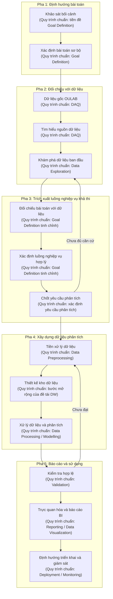
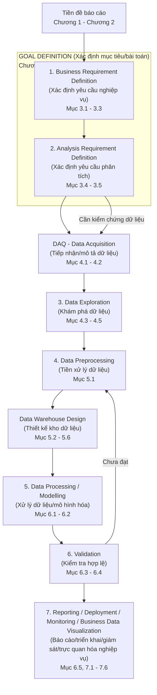

# Mục Lục Và Luồng Công Việc Báo Cáo Data Warehouse Với Dữ Liệu OULAB

## Tóm Tắt Và Cách Đọc File

File này dùng để thống nhất cách nhóm xây dựng báo cáo Data Warehouse với dữ liệu OULAB/OULAD. Nội dung không chỉ là mục lục, mà còn là khung kiểm soát luồng làm việc và sản phẩm bàn giao của từng phần.

Cách đọc đề xuất:

1. Đọc sơ đồ đầu tiên để hiểu **luồng làm việc thực tế của nhóm**: nhóm khảo sát bài toán sơ bộ, kiểm tra dữ liệu, rồi tinh chỉnh yêu cầu phân tích.
2. Đọc sơ đồ thứ hai để hiểu **quy trình phân tích dữ liệu chuẩn** và cách các chương trong báo cáo được đặt vào quy trình đó.
3. Đọc mục lục theo chương để biết báo cáo nên viết theo trình tự nào.
4. Đọc bảng sản phẩm đầu ra ở cuối file để biết mỗi mục cần tạo artifact cụ thể gì, artifact đó dùng làm đầu vào cho phần nào.

Nguyên tắc dùng file: **sơ đồ thực tế giúp nhóm làm việc**, **mục lục giúp nhóm viết báo cáo theo chuẩn**, còn **bảng sản phẩm đầu ra giúp nhóm chia việc và kiểm soát kết quả**.

## Phần 1. Mục Lục / Luồng Công Việc Theo Chương

*Sơ đồ trên mô tả luồng làm việc thực tế của nhóm: nhóm khảo sát bài toán sơ bộ trước, sau đó đối chiếu với dữ liệu OULAB để tinh chỉnh thành các luồng nghiệp vụ và yêu cầu phân tích khả thi. Chú thích trong từng ô cho biết bước đó tương ứng với phần nào trong quy trình phân tích dữ liệu chuẩn.*

*Sơ đồ trên mô tả quy trình phân tích dữ liệu chuẩn và vị trí tương ứng của từng phần trong mục lục. Goal Definition là bước cha của Chương 3, bao gồm xác định yêu cầu nghiệp vụ và xác định yêu cầu phân tích. Trong ảnh quy trình, bước DAQ nằm ngay sau Goal Definition; trong báo cáo này DAQ được thể hiện ở Chương 4 khi giới thiệu và mô tả dữ liệu OULAB. Riêng bước thiết kế kho dữ liệu là phần bổ sung cần có vì đề tài thuộc Data Warehouse.*

### Chương 1. Bối cảnh đào tạo từ xa và động cơ thực hiện đề tài

&emsp;1.1. Bối cảnh và sự cần thiết của đào tạo từ xa  
&emsp;&emsp;Mục đích: Giới thiệu bối cảnh chung.  
&emsp;&emsp;Output: Lý do cần quan tâm đến chất lượng đào tạo từ xa.  

&emsp;1.2. Vấn đề tổng quan trong quản lý và cải thiện chất lượng đào tạo  
&emsp;&emsp;Mục đích: Đặt vấn đề ở mức tổng quan.  
&emsp;&emsp;Output: Các nhóm vấn đề cần được hỗ trợ bằng dữ liệu.  

&emsp;1.3. Vai trò của dữ liệu trong phân tích hoạt động học tập  
&emsp;&emsp;Mục đích: Nối vấn đề đào tạo với nhu cầu phân tích dữ liệu.  
&emsp;&emsp;Output: Lập luận cho việc cần khai thác dữ liệu học tập.  

&emsp;1.4. Giới thiệu nguồn dữ liệu OULAB  
&emsp;&emsp;Mục đích: Giới thiệu nguồn dữ liệu dùng trong đề tài.  
&emsp;&emsp;Output: Dữ liệu OULAB được chọn làm nguồn phân tích.  

&emsp;1.5. Định hướng tiếp cận của đề tài  
&emsp;&emsp;Mục đích: Nêu hướng tiếp cận ở mức khái quát.  
&emsp;&emsp;Output: Định hướng xây dựng Data Warehouse và BI cho các chương sau.

### Chương 2. Cơ sở về Business Intelligence và Data Warehouse

&emsp;2.1. Tổng quan về Business Intelligence  
&emsp;&emsp;Mục đích: Cung cấp khái niệm nền.  
&emsp;&emsp;Output: Cách hiểu thống nhất về BI.  

&emsp;2.2. Vai trò của BI trong hỗ trợ ra quyết định giáo dục  
&emsp;&emsp;Mục đích: Liên hệ BI với bối cảnh giáo dục.  
&emsp;&emsp;Output: Lý do BI phù hợp với đề tài.  

&emsp;2.3. Tổng quan về Data Warehouse  
&emsp;&emsp;Mục đích: Giới thiệu nền tảng lưu trữ phục vụ phân tích.  
&emsp;&emsp;Output: Cách hiểu thống nhất về Data Warehouse.  

&emsp;2.4. Mô hình dữ liệu đa chiều và OLAP  
&emsp;&emsp;Mục đích: Trình bày cơ sở cho phân tích nhiều chiều.  
&emsp;&emsp;Output: Nền tảng cho thiết kế và truy vấn phân tích.  

&emsp;2.5. Mối quan hệ giữa Data Warehouse và BI  
&emsp;&emsp;Mục đích: Làm rõ vai trò của kho dữ liệu trong hệ thống BI.  
&emsp;&emsp;Output: Khung liên kết giữa dữ liệu, kho dữ liệu và báo cáo BI.  

&emsp;2.6. Quy trình phân tích dữ liệu sử dụng trong đề tài  
&emsp;&emsp;Mục đích: Xác định trình tự thực hiện.  
&emsp;&emsp;Output: Khung làm việc cho Chương 3 đến Chương 7.

### Chương 3. Goal Definition: Xác định yêu cầu nghiệp vụ và yêu cầu phân tích

&emsp;3.1. Xác định bối cảnh nghiệp vụ và vấn đề cần giải quyết  
&emsp;&emsp;Mục đích: Đặt bài toán phân tích theo góc nhìn nghiệp vụ.  
&emsp;&emsp;Output: Vấn đề nghiệp vụ sơ bộ cần phân tích.  

&emsp;3.2. Xác định đối tượng sử dụng và nhu cầu thông tin  
&emsp;&emsp;Mục đích: Làm rõ ai sẽ dùng kết quả phân tích và họ cần biết điều gì.  
&emsp;&emsp;Input: Vấn đề nghiệp vụ sơ bộ.  
&emsp;&emsp;Output: Nhóm người dùng và nhu cầu thông tin chính.  

&emsp;3.3. Xác định mục tiêu phân tích  
&emsp;&emsp;Mục đích: Chuyển vấn đề nghiệp vụ thành mục tiêu có thể phân tích.  
&emsp;&emsp;Input: Output của mục 3.1 và 3.2.  
&emsp;&emsp;Output: Mục tiêu phân tích của đề tài.  

&emsp;3.4. Xác định câu hỏi phân tích và chỉ số cần theo dõi  
&emsp;&emsp;Mục đích: Làm rõ các câu hỏi cần trả lời bằng dữ liệu.  
&emsp;&emsp;Input: Mục tiêu phân tích.  
&emsp;&emsp;Output: Câu hỏi phân tích và nhóm chỉ số dự kiến.  

&emsp;3.5. Xác định phạm vi, giả định và giới hạn của bài toán  
&emsp;&emsp;Mục đích: Chốt ranh giới để bài báo cáo không bị lan man.  
&emsp;&emsp;Input: Câu hỏi phân tích và nhóm chỉ số dự kiến.  
&emsp;&emsp;Output: Phạm vi phân tích, giả định và giới hạn ban đầu.

### Chương 4. Thu thập, mô tả và khám phá dữ liệu OULAB

&emsp;4.1. Giới thiệu nguồn dữ liệu OULAB  
&emsp;&emsp;Mục đích: Trình bày nguồn dữ liệu được sử dụng trong đề tài.  
&emsp;&emsp;Output: Nguồn dữ liệu OULAB được xác định làm dữ liệu phân tích.  

&emsp;4.2. Mô tả cấu trúc và ý nghĩa dữ liệu  
&emsp;&emsp;Mục đích: Hiểu dữ liệu nguồn trước khi xử lý.  
&emsp;&emsp;Input: Bộ dữ liệu OULAB và tài liệu mô tả nếu có.  
&emsp;&emsp;Output: Mô tả bảng, trường dữ liệu và quan hệ chính.  

&emsp;4.3. Đánh giá mức độ phù hợp của dữ liệu với yêu cầu phân tích  
&emsp;&emsp;Mục đích: Kiểm tra dữ liệu có hỗ trợ được các câu hỏi phân tích hay không.  
&emsp;&emsp;Input: Yêu cầu phân tích ở Chương 3 và mô tả dữ liệu ở mục 4.2.  
&emsp;&emsp;Output: Phần yêu cầu có thể đáp ứng, phần cần điều chỉnh và giới hạn dữ liệu.  

&emsp;4.4. Khám phá dữ liệu ban đầu  
&emsp;&emsp;Mục đích: Đánh giá đặc điểm, chất lượng và khả năng khai thác của dữ liệu.  
&emsp;&emsp;Input: Dữ liệu OULAB và mô tả dữ liệu.  
&emsp;&emsp;Output: Nhận xét EDA, vấn đề dữ liệu và phát hiện ban đầu.  

&emsp;4.5. Tổng hợp nhận xét và định hướng tiền xử lý  
&emsp;&emsp;Mục đích: Chốt các điểm cần xử lý trước khi thiết kế kho dữ liệu.  
&emsp;&emsp;Input: Output của mục 4.3 và 4.4.  
&emsp;&emsp;Output: Định hướng tiền xử lý dữ liệu.

### Chương 5. Tiền xử lý và thiết kế kho dữ liệu

&emsp;5.1. Tiền xử lý dữ liệu  
&emsp;&emsp;Mục đích: Chuẩn bị dữ liệu đủ sạch để phân tích.  
&emsp;&emsp;Input: Dữ liệu nguồn và vấn đề phát hiện ở Chương 4.  
&emsp;&emsp;Output: Dữ liệu đã được làm sạch/chuyển đổi ở mức cần thiết.  

&emsp;5.2. Xác định yêu cầu thiết kế kho dữ liệu  
&emsp;&emsp;Mục đích: Xác định kho dữ liệu cần đáp ứng điều gì.  
&emsp;&emsp;Input: Yêu cầu phân tích và dữ liệu đã tìm hiểu.  
&emsp;&emsp;Output: Yêu cầu thiết kế kho dữ liệu.  

&emsp;5.3. Thiết kế mô hình dữ liệu khái niệm  
&emsp;&emsp;Mục đích: Mô tả các thực thể và quan hệ chính ở mức khái quát.  
&emsp;&emsp;Input: Yêu cầu thiết kế và hiểu biết về dữ liệu.  
&emsp;&emsp;Output: Mô hình khái niệm.  

&emsp;5.4. Thiết kế mô hình dữ liệu logic  
&emsp;&emsp;Mục đích: Chuyển mô hình khái niệm thành cấu trúc phân tích logic.  
&emsp;&emsp;Input: Mô hình khái niệm.  
&emsp;&emsp;Output: Mô hình logic phục vụ phân tích.  

&emsp;5.5. Thiết kế mô hình dữ liệu vật lý  
&emsp;&emsp;Mục đích: Cụ thể hóa thiết kế để có thể triển khai lưu trữ.  
&emsp;&emsp;Input: Mô hình logic và ràng buộc triển khai.  
&emsp;&emsp;Output: Mô hình vật lý.  

&emsp;5.6. Định hướng xây dựng luồng nạp và biến đổi dữ liệu  
&emsp;&emsp;Mục đích: Mô tả cách đưa dữ liệu vào kho dữ liệu.  
&emsp;&emsp;Input: Dữ liệu đã tiền xử lý và mô hình vật lý.  
&emsp;&emsp;Output: Định hướng ETL/ELT cho bước xử lý.

### Chương 6. Xử lý dữ liệu, phân tích và kiểm tra hợp lệ

&emsp;6.1. Xây dựng dữ liệu phục vụ phân tích  
&emsp;&emsp;Mục đích: Tạo dữ liệu đầu vào cho phân tích/BI.  
&emsp;&emsp;Input: Thiết kế kho dữ liệu và luồng xử lý.  
&emsp;&emsp;Output: Dữ liệu phân tích đã được tổ chức.  

&emsp;6.2. Thực hiện phân tích theo yêu cầu đã xác định  
&emsp;&emsp;Mục đích: Trả lời các câu hỏi phân tích.  
&emsp;&emsp;Input: Dữ liệu phân tích và yêu cầu phân tích.  
&emsp;&emsp;Output: Kết quả phân tích ban đầu.  

&emsp;6.3. Kiểm tra tính đúng đắn và nhất quán của kết quả  
&emsp;&emsp;Mục đích: Đảm bảo kết quả đáng tin cậy.  
&emsp;&emsp;Input: Kết quả phân tích và tiêu chí đã xác định.  
&emsp;&emsp;Output: Nhận xét kiểm tra/validation.  

&emsp;6.4. Điều chỉnh quy trình xử lý khi kết quả chưa đạt yêu cầu  
&emsp;&emsp;Mục đích: Thể hiện vòng lặp tinh chỉnh của quy trình phân tích.  
&emsp;&emsp;Input: Kết quả kiểm tra ở mục 6.3.  
&emsp;&emsp;Output: Dữ liệu hoặc kết quả phân tích đã được điều chỉnh.  

&emsp;6.5. Tổng hợp kết quả phân tích  
&emsp;&emsp;Mục đích: Chuẩn bị nội dung cho báo cáo BI.  
&emsp;&emsp;Input: Kết quả đã kiểm tra.  
&emsp;&emsp;Output: Tập kết quả/insight dùng cho trực quan hóa.

### Chương 7. Trực quan hóa, báo cáo BI và định hướng triển khai

&emsp;7.1. Xác định yêu cầu trình bày kết quả  
&emsp;&emsp;Mục đích: Xác định cách truyền đạt kết quả cho người dùng.  
&emsp;&emsp;Input: Yêu cầu nghiệp vụ và kết quả phân tích.  
&emsp;&emsp;Output: Yêu cầu báo cáo/dashboard.  

&emsp;7.2. Thiết kế báo cáo và dashboard BI  
&emsp;&emsp;Mục đích: Trực quan hóa kết quả phân tích.  
&emsp;&emsp;Input: Yêu cầu trình bày và kết quả phân tích.  
&emsp;&emsp;Output: Báo cáo/dashboard BI.  

&emsp;7.3. Trình bày kết quả phân tích và insight chính  
&emsp;&emsp;Mục đích: Diễn giải ý nghĩa của kết quả.  
&emsp;&emsp;Input: Dashboard và kết quả phân tích.  
&emsp;&emsp;Output: Insight chính và nhận định.  

&emsp;7.4. Đánh giá mức độ đáp ứng yêu cầu nghiệp vụ  
&emsp;&emsp;Mục đích: Kiểm tra báo cáo có trả lời đúng bài toán ban đầu không.  
&emsp;&emsp;Input: Insight và yêu cầu nghiệp vụ.  
&emsp;&emsp;Output: Đánh giá mức độ đáp ứng.  

&emsp;7.5. Đề xuất định hướng triển khai và giám sát  
&emsp;&emsp;Mục đích: Nêu cách sử dụng kết quả trong thực tế.  
&emsp;&emsp;Input: Báo cáo BI và đánh giá đáp ứng.  
&emsp;&emsp;Output: Đề xuất triển khai, cập nhật và giám sát.  

&emsp;7.6. Kết luận, hạn chế và hướng phát triển  
&emsp;&emsp;Mục đích: Khép lại báo cáo và chỉ ra phần có thể cải thiện.  
&emsp;&emsp;Output: Kết luận, hạn chế và hướng phát triển.

## Phần 2. Bảng Sản Phẩm Đầu Ra Cụ Thể Theo Mục

Bảng này không thay thế mục lục. Mục đích của bảng là giúp nhóm kiểm soát sản phẩm bàn giao cụ thể của từng phần, tránh viết báo cáo theo kiểu mô tả chung nhưng không tạo ra đầu ra dùng được cho các bước sau.

| Mục | Sản phẩm đầu ra cụ thể | Mục đích sử dụng | Làm đầu vào cho phần nào | Ghi chú kiểm soát phạm vi |
|---|---|---|---|---|
| 1.1 - 1.5 | Đoạn mô tả bối cảnh đề tài; đoạn nêu vấn đề; đoạn lý do chọn dữ liệu OULAB/OULAD; định hướng tiếp cận bằng Data Warehouse và BI. | Dẫn nhập để người đọc hiểu vì sao đề tài cần thiết. | Chương 3 khi phát biểu bài toán và xác định mục tiêu. | Chỉ nêu vấn đề tổng quan, chưa đi sâu vào KPI hoặc thiết kế hệ thống. |
| 2.1 - 2.6 | Bảng/đoạn tổng hợp khái niệm BI, Data Warehouse, OLAP, mô hình dữ liệu đa chiều; sơ đồ quy trình phân tích dữ liệu chuẩn dùng trong báo cáo. | Tạo nền tảng lý thuyết và khung phương pháp. | Toàn bộ Chương 3 đến Chương 7. | Không biến chương lý thuyết thành phần liệt kê công nghệ triển khai. |
| 3.1 | Phát biểu bài toán hoàn chỉnh: bối cảnh, vấn đề cần giải quyết, đối tượng ra quyết định, quyết định cần hỗ trợ. | Chốt bài toán ở mức nghiệp vụ. | Mục 3.2, 3.3 và phần đánh giá đáp ứng ở Chương 7. | Vì OULAB/OULAD không công khai nghiệp vụ đầy đủ, cần ghi rõ đây là bài toán nhóm suy luận từ bối cảnh và dữ liệu. |
| 3.2 | Bảng đối tượng sử dụng và nhu cầu thông tin: người xem dashboard, nhu cầu theo dõi, quyết định cần đưa ra. | Xác định báo cáo phục vụ ai và phục vụ quyết định nào. | Mục 3.3, 3.4 và thiết kế dashboard ở Chương 7. | Không cần mô tả mọi vai trò trong một trường đại học; chỉ giữ các vai trò liên quan đến phân tích. |
| 3.3 | Bảng mục tiêu phân tích hoặc cây mục tiêu: mục tiêu chính, mục tiêu con, ý nghĩa nghiệp vụ. | Chuyển vấn đề nghiệp vụ thành mục tiêu phân tích. | Mục 3.4 và bảng KPI. | Mỗi mục tiêu nên có khả năng kiểm chứng bằng dữ liệu. |
| 3.4 | Cây yêu cầu phân tích; bảng câu hỏi phân tích; bảng KPI dự kiến gồm tên chỉ số, công thức, ý nghĩa, cột dữ liệu nguồn và dashboard sử dụng. | Làm cầu nối giữa bài toán và thiết kế dữ liệu/phân tích. | Chương 4 để kiểm tra dữ liệu; Chương 5 để thiết kế fact/dimension; Chương 7 để thiết kế dashboard. | Chỉ giữ KPI có dữ liệu hỗ trợ hoặc có thể giải thích rõ giả định. |
| 3.5 | Bảng phạm vi, giả định và giới hạn: phạm vi phân tích, phần không làm, giả định về dữ liệu, rủi ro sai lệch. | Ngăn báo cáo bị lan man và giúp đánh giá kết quả công bằng. | Chương 4 khi đánh giá dữ liệu và Chương 7 khi nêu hạn chế. | Cần ghi rõ các giả định quan trọng như dữ liệu thời gian tương đối nếu có sử dụng. |
| 4.1 | Bảng inventory dữ liệu: tên file/bảng, mô tả ngắn, số dòng, số cột, vai trò trong phân tích. | Chứng minh nhóm biết dữ liệu đang dùng gồm những gì. | Mục 4.2, 4.3 và thiết kế dữ liệu ở Chương 5. | Thống nhất tên gọi OULAB/OULAD trong toàn báo cáo. |
| 4.2 | Data dictionary; mô tả khóa chính/khóa liên kết; sơ đồ quan hệ dữ liệu nguồn ở mức tổng quan nếu cần. | Hiểu cấu trúc dữ liệu trước khi khám phá và thiết kế. | Mục 4.3, 4.4 và mô hình dữ liệu ở Chương 5. | Không cần biến thành ERD triển khai đầy đủ nếu chưa nạp vào CSDL quan hệ. |
| 4.3 | Bảng đối chiếu yêu cầu phân tích với dữ liệu: câu hỏi/KPI nào có dữ liệu đáp ứng, đáp ứng một phần hoặc không đáp ứng. | Kiểm tra tính khả thi của bài toán với dữ liệu thật. | Mục 4.5 và điều chỉnh yêu cầu ở Chương 3 nếu cần. | Đây là điểm nối giữa luồng làm thực tế và mục lục chuẩn. |
| 4.4 | Báo cáo EDA ngắn: thống kê mô tả, biểu đồ phân bố chính, kiểm tra null/trùng lặp/giá trị đặc biệt, nhận xét tương quan nếu phù hợp. | Phát hiện đặc điểm và vấn đề dữ liệu. | Mục 4.5 và quy tắc tiền xử lý ở Chương 5. | Chỉ chọn biểu đồ phục vụ câu hỏi phân tích, không vẽ cho đủ số lượng. |
| 4.5 | Danh sách vấn đề dữ liệu và định hướng xử lý: vấn đề, mức ảnh hưởng, hướng xử lý đề xuất. | Chốt việc cần làm trước khi thiết kế và xử lý dữ liệu. | Mục 5.1. | Mỗi vấn đề nên truy ngược được về EDA hoặc yêu cầu phân tích. |
| 5.1 | Bảng quy tắc tiền xử lý: cột/bảng bị ảnh hưởng, vấn đề, cách xử lý, lý do, output sau xử lý. | Làm dữ liệu sạch và có thể lặp lại quy trình xử lý. | Mục 5.2 - 5.6 và Chương 6. | Không sửa dữ liệu tùy tiện; mọi quy tắc phải có lý do. |
| 5.2 | Bảng yêu cầu thiết kế kho dữ liệu: grain dự kiến, nhóm chỉ số, chiều phân tích, nhu cầu dashboard tương ứng. | Chuyển yêu cầu phân tích thành yêu cầu thiết kế DWH. | Mục 5.3 - 5.6. | Grain, chỉ số và chiều phân tích phải khớp với KPI ở Chương 3. |
| 5.3 | Mô hình dữ liệu khái niệm: các thực thể chính và quan hệ giữa chúng. | Mô tả dữ liệu ở mức nghiệp vụ trước khi vào bảng logic/vật lý. | Mục 5.4. | Giữ ở mức khái quát, tránh sa vào tên cột kỹ thuật. |
| 5.4 | Mô hình logic: star schema hoặc snowflake schema; danh sách fact/dimension; mô tả quan hệ chính. | Thiết kế cấu trúc phân tích độc lập với công nghệ cụ thể. | Mục 5.5, 5.6 và Chương 6. | Fact/dimension phải phục vụ trực tiếp các câu hỏi phân tích và dashboard. |
| 5.5 | Mô hình vật lý: tên bảng, khóa, kiểu dữ liệu chính, ràng buộc chính; ERD hoặc schema vật lý nếu triển khai CSDL. | Cụ thể hóa thiết kế để có thể nạp dữ liệu. | Mục 5.6 và Chương 6. | Không cần mô tả mọi chi tiết hệ quản trị nếu báo cáo không triển khai sâu. |
| 5.6 | Sơ đồ kiến trúc dữ liệu và ETL/ELT: nguồn dữ liệu -> staging/ODS -> DWH -> data mart/dashboard; mapping nguồn sang đích ở mức tổng quan. | Mô tả dữ liệu đi qua hệ thống như thế nào. | Chương 6. | Nếu có dùng công cụ cụ thể, chỉ nêu khi nó ảnh hưởng đến cách triển khai. |
| 6.1 | Bảng dữ liệu phân tích đã xây dựng: bảng đầu ra, nội dung, grain, chỉ số có sẵn, mục đích dùng. | Chứng minh dữ liệu đã sẵn sàng cho phân tích/BI. | Mục 6.2 và Chương 7. | Không chỉ nói “đã nạp dữ liệu”; cần có danh sách output phân tích. |
| 6.2 | Bảng kết quả phân tích theo câu hỏi: câu hỏi, cách tính/logic phân tích, kết quả chính, nhận xét ban đầu. | Trả lời các yêu cầu phân tích đã chốt. | Mục 6.5 và Chương 7. | Kết quả phải liên kết lại với câu hỏi/KPI ở Chương 3. |
| 6.3 | Checklist validation: kiểm tra số dòng, khóa, quan hệ, công thức KPI, đối chiếu mẫu, bất thường còn lại. | Đảm bảo kết quả đủ tin cậy trước khi báo cáo. | Mục 6.4, 6.5 và Chương 7. | Validation nên kiểm tra cả dữ liệu lẫn chỉ số, không chỉ kiểm tra chạy được pipeline. |
| 6.4 | Bảng điều chỉnh sau validation: lỗi/phát hiện, nguyên nhân, cách sửa, phần bị ảnh hưởng, trạng thái. | Thể hiện vòng lặp tinh chỉnh của quy trình phân tích. | Mục 6.5 và phụ lục nếu cần. | Chỉ ghi các điều chỉnh ảnh hưởng đến kết quả hoặc quyết định thiết kế. |
| 6.5 | Bảng tổng hợp insight/kết quả cuối: insight, bằng chứng dữ liệu, ý nghĩa, liên hệ với câu hỏi phân tích. | Chuẩn bị nội dung để đưa lên dashboard và báo cáo BI. | Chương 7. | Insight phải có dữ liệu chứng minh, tránh nhận xét cảm tính. |
| 7.1 | Bảng yêu cầu trình bày dashboard: người xem, mục tiêu xem, câu hỏi cần trả lời, chỉ số chính. | Xác định dashboard cần thể hiện điều gì. | Mục 7.2. | Không thiết kế dashboard tách rời khỏi yêu cầu nghiệp vụ. |
| 7.2 | Dashboard specification: danh sách dashboard, biểu đồ, slicer/filter, KPI card, tương tác drill-down nếu có. | Làm bản thiết kế trước khi dựng dashboard. | Mục 7.3 và 7.4. | Chọn biểu đồ theo câu hỏi phân tích, không chọn chỉ để đa dạng hình thức. |
| 7.3 | Dashboard hoặc ảnh chụp dashboard; bảng insight chính đi kèm từng dashboard. | Trình bày kết quả phân tích thành thông tin dễ hiểu. | Mục 7.4 và 7.5. | Mỗi dashboard nên gắn với ít nhất một câu hỏi phân tích rõ ràng. |
| 7.4 | Bảng đánh giá đáp ứng yêu cầu: yêu cầu/câu hỏi ban đầu, dashboard hoặc insight trả lời, mức độ đáp ứng, phần chưa đáp ứng. | Kiểm tra báo cáo có giải quyết đúng bài toán không. | Mục 7.5, 7.6. | Đây là phần nối lại với Goal Definition, không nên bỏ qua. |
| 7.5 | Đề xuất triển khai và giám sát: cách cập nhật dữ liệu, tần suất, người dùng, rủi ro vận hành, hướng monitoring. | Nêu cách kết quả có thể được sử dụng trong thực tế. | Mục 7.6. | Chỉ đề xuất ở mức phù hợp phạm vi môn học, không cần cam kết triển khai thật nếu nhóm không làm. |
| 7.6 | Kết luận, hạn chế, bài học nhóm thu được và hướng phát triển. | Khép lại báo cáo và nêu phần có thể cải thiện. | Phần kết luận cuối báo cáo. | Nên ghi hạn chế dựa trên dữ liệu/quy trình thật, không viết chung chung. |
